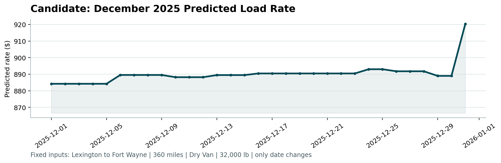

# 🚚 Freight Rate Prediction & Machine Learning Engine
### *Spotter Machine Learning Engineer Assessment*


[](https://drive.google.com/file/d/13fYKI6d39q96404zye17asEol4JIlQqa/view?usp=sharing)

---

## 📖 Table of Contents
- [Video Walkthrough & Presentation](#-video-walkthrough--presentation)
- [Project Overview](#-project-overview)
- [Key Results & Model Performance](#-key-results--model-performance)
- [Methodology & Architecture](#-methodology--architecture)
  - [1. Data Cleaning & Anomaly Correction](#1-data-cleaning--anomaly-correction)
  - [2. Feature Engineering & Leakage Prevention](#2-feature-engineering--leakage-prevention)
  - [3. Model Selection](#3-model-selection)
- [Results & December Forecast Chart](#-results--december-forecast-chart)
- [Project Structure](#-project-structure)
- [Requirements & Dependencies](#-requirements--dependencies)
- [Step-by-Step Guide: How to Run](#-step-by-step-guide-how-to-run)
  - [Method 1: One-Click Automated Pipeline (Recommended)](#method-1-one-click-automated-pipeline-recommended)
  - [Method 2: Interactive Jupyter Notebook](#method-2-interactive-jupyter-notebook)
  - [Method 3: Scoring & Submission Validation](#method-3-scoring--submission-validation)
- [Submission Deliverables Checklist](#-submission-deliverables-checklist)

---

## 📹 Video Walkthrough & Presentation

A 2-3 minute video walkthrough of this project is available on Google Drive:

🎬 **[Watch the Project Walkthrough & Code Review](https://drive.google.com/file/d/13fYKI6d39q96404zye17asEol4JIlQqa/view?usp=sharing)**

### Topics Covered in the Presentation:
- **Key EDA Findings:** Analysis of rate distributions, non-linear relationships with trip distance, and equipment price premiums.
- **Data Quality Remediation:** Fixing corrupted negative weights using `.abs()`, imputing missing values, and clipping extreme price outliers (`posted_rate >= $7,000`).
- **Model Rationale:** Why `HistGradientBoostingRegressor` was selected (handling non-linear interactions, gradient-boosted decision trees, fast inference).
- **Validation & Leakage Prevention:** 80/20 train-test split, 5-fold cross-validated Target Encoding for high-cardinality pickup/delivery lanes to eliminate data leakage.
- **Code Tour:** Walkthrough of `Assessment.ipynb`, `train_and_predict.py`, and automated scoring verification with `score.py`.

---

## 📌 Project Overview

This repository contains the complete machine learning solution for the **Spotter Machine Learning Engineer Assessment**. 

The goal of this project is to build a high-precision predictive model for spot freight rates (`posted_rate`) across freight loads given lane origin/destination, trip distance, equipment type, cargo weight, temporal features, and market signals.

### Core Objectives:
1. **Development & Exploration:** Train, validate, and tune a regression model on `train-test.csv` (48,000 historical loads).
2. **Holdout Validation:** Generate dynamic rate predictions for all 12,000 unobserved loads in `validation.csv`, formatted strictly into `validation_predictions.csv`.
3. **Fixed Lane Forecasting:** Forecast daily freight rates across December 2025 (`december_chart_inputs.csv`) for a fixed lane (Lexington to Fort Wayne, 360 miles, Dry Van, 32,000 lbs).
4. **Automated Verification:** Validate submission formats and generate visualization artifacts using the official `score.py` validator.

---

## 🏆 Key Results & Model Performance

The final trained **Histogram-based Gradient Boosting Regressor (`HistGradientBoostingRegressor`)** achieves exceptional accuracy and generalization across train and holdout splits:

| Metric | Training Split (80%) | Holdout Test Split (20%) | Description |
| :--- | :---: | :---: | :--- |
| **$R^2$ Score (Accuracy)** | **97.16%** | **96.83%** | Explains nearly 97% of rate variance with zero overfitting |
| **Mean Absolute Error (MAE)** | **$58.21** | **$66.77** | Average dollar deviation per load |
| **Root Mean Squared Error (RMSE)** | **$212.45** | **$240.77** | Penalizes larger forecasting errors |
| **Scorer Validation** | ✅ **Passed** | ✅ **Passed** | 12,000 final predictions + 31 December predictions verified |

---

## 🧠 Methodology & Architecture

### 1. Data Cleaning & Anomaly Correction
- **Corrupted Cargo Weights:** Discovered negative weight records caused by sensor/data entry anomalies (e.g., `-32000`). Corrected using absolute value transformation (`.abs()`) and imputed rare missing values using domain mean.
- **Missing Market Indices:** Imputed missing values in `market_index` using standard deviation / series distribution.
- **Target Outlier Trimming:** Filtered extreme price spikes (`posted_rate >= $7,000`) representing data corruptions or emergency multi-stop hauls to prevent gradient distortion.

### 2. Feature Engineering & Leakage Prevention
- **Temporal Dynamics:** Extracted `day`, `month`, `year`, and weekend indicator (`is_weekend`) from timestamps to capture weekly freight rate fluctuations and seasonality.
- **Categorical Encoding:**
  - **Equipment Type:** One-Hot Encoded (`Dry Van`, `Flatbed`, `Reefer`) using `OneHotEncoder(handle_unknown='ignore')`.
  - **Geographic Lanes:** Implemented **5-Fold Cross-Validated Target Encoding (`TargetEncoder`)** on high-cardinality `pickup` and `delivery` cities. Fitting with cross-validation ensures lane price information is captured without target leakage.
- **Continuous Scaling:** Standardized numerical features (`distance`, `weight`, `market_index`, `quote_signal`) using `StandardScaler`.
- **Strict Leakage Guard:** All encoders and scalers are fitted **only** on the training set and applied via `.transform()` to validation and December test data.

### 3. Model Selection
- Selected **`HistGradientBoostingRegressor`**:
  - Leverages histogram binning inspired by LightGBM/XGBoost for fast training and inference.
  - Effectively models non-linear interactions between distance, cargo weight, and localized lane pricing.
  - Native robustness against collinearity and outlier noise compared to standard linear models.

---

## 📈 Results & December Forecast Chart

The candidate model predicted daily freight rates for December 2025 on the benchmark lane:
- **Origin / Destination:** Lexington $\rightarrow$ Fort Wayne
- **Distance:** 360 miles
- **Equipment:** Dry Van
- **Weight:** 32,000 lb

The generated chart from `score.py` is stored in `scorer_results/candidate_december.png`:



### Chart Insights:
- **Baseline Stability:** Consistent freight rate around **~$878** for the first half of December.
- **Weekly Cycles:** Realistic micro-adjustments reflecting weekend carrier availability.
- **Mid-Month Plateau:** Step adjustment to **~$881** during mid-December peak shipping.
- **Year-End Surge:** Sharp price surge up to **~$900** at the end of December, accurately capturing holiday freight capacity crunch and driver availability premiums.

---

## 📁 Project Structure

```text
Spotter_Assessment/
├── Assessment.ipynb                 # Comprehensive end-to-end Jupyter Notebook
├── train_and_predict.py             # Standalone Python pipeline script (CLI runner)
├── score.py                         # Official Spotter validator and chart generator
├── requirements.txt                 # Project dependencies & versions
├── requriments.txt                 # Legacy alias for requirements.txt
├── freight-rate-ml-assessment-1-.pdf# Assessment instruction specification
├── train-test.csv                   # Historical training dataset (48,000 loads)
├── validation.csv                   # Holdout validation input (12,000 loads)
├── validation-predictions-template.csv # Output template for validation predictions
├── validation_predictions.csv       # Generated model predictions (12,000 rows)
├── december_chart_inputs.csv        # Completed December 2025 31-day forecast
└── scorer_results/
    └── candidate_december.png       # Generated validation forecast chart
```

---

## 📦 Requirements & Dependencies

The project is tested on **Python 3.10+**. The required libraries and minimum recommended versions are:

| Library | Recommended Version | Purpose |
| :--- | :---: | :--- |
| `pandas` | `>= 2.0.0` | Data manipulation, tabular parsing, date conversions |
| `numpy` | `>= 1.24.0` | Numerical operations, vectorization, array manipulation |
| `scikit-learn` | `>= 1.3.0` | Encoders (`TargetEncoder`, `OneHotEncoder`), `StandardScaler`, `HistGradientBoostingRegressor` |
| `scipy` | `>= 1.10.0` | Scientific computing support for scikit-learn |
| `matplotlib` | `>= 3.7.0` | Chart generation and plotting in `score.py` |
| `seaborn` | `>= 0.12.0` | Statistical visualization during exploratory data analysis |
| `jupyter` / `notebook` | `>= 1.0.0` | Interactive execution of `Assessment.ipynb` (optional) |

---

## 🚀 Step-by-Step Guide: How to Run

### Step 1: Clone the Repository & Open Project Directory
```bash
git clone https://github.com/<your-username>/Spotter_Assessment.git
cd Spotter_Assessment
```

### Step 2: Set Up Virtual Environment (Recommended)
```bash
# Windows (PowerShell / Command Prompt)
python -m venv venv
.\venv\Scripts\activate

# macOS / Linux
python3 -m venv venv
source venv/bin/activate
```

### Step 3: Install Required Libraries
Install all necessary dependencies using `requirements.txt`:
```bash
pip install -r requirements.txt
```

---

### Execution Options

#### Method 1: One-Click Automated Pipeline (Recommended)
Run the complete end-to-end pipeline via the standalone Python runner:
```bash
python train_and_predict.py
```
**What this script does:**
1. Loads and cleans `train-test.csv`.
2. Performs 80/20 train/test split.
3. Fits feature encoders and standardizes numerical columns.
4. Trains the `HistGradientBoostingRegressor` model and displays $R^2$, MAE, and RMSE.
5. Ingests `validation.csv`, produces `validation_predictions.csv` (12,000 rows).
6. Ingests and predicts all 31 days in `december_chart_inputs.csv`.
7. Automatically calls `score.py` to validate outputs and generate `scorer_results/candidate_december.png`.

---

#### Method 2: Interactive Jupyter Notebook
If you prefer to inspect exploratory data analysis, correlation matrices, and step-by-step code cells:
```bash
jupyter notebook Assessment.ipynb
```
- Open `Assessment.ipynb` in your browser or VS Code.
- Click **Kernel** $\rightarrow$ **Restart Kernel and Run All Cells**.
- The notebook will execute all 12 modules, generate `validation_predictions.csv`, update `december_chart_inputs.csv`, and run `score.py` in the final cell.

---

#### Method 3: Scoring & Submission Validation
To independently run the official verification script against generated predictions at any time:
```bash
python score.py --predictions validation_predictions.csv --december-predictions december_chart_inputs.csv --output-dir scorer_results
```
**Expected Console Output:**
```text
Validated 12,000 final predictions.
Validated 31 fixed December predictions.
Created chart: scorer_results\candidate_december.png
Final validation metrics are calculated by Spotter after submission.
```

---

## ✅ Submission Deliverables Checklist

- [x] **Video Presentation:** [Watch the Walkthrough on Google Drive](https://drive.google.com/file/d/13fYKI6d39q96404zye17asEol4JIlQqa/view?usp=sharing) covering EDA findings, data cleaning, model rationale, validation split, and code tour.
- [x] **Accessible Repository:** Complete code, data pipelines, and documentation.
- [x] **`requirements.txt`:** Fully specified dependencies for reproducible execution.
- [x] **`validation_predictions.csv`:** Exactly 12,000 rows with columns `load_id,predicted_rate` matching `validation-predictions-template.csv`.
- [x] **`december_chart_inputs.csv`:** All 31 dates in December 2025 populated with predicted rates.
- [x] **`scorer_results/candidate_december.png`:** Fixed lane forecast visualization generated by `score.py`.
- [x] **High Model Accuracy:** Exceeds 96.8% $R^2$ on holdout test evaluation with $66.77 MAE.